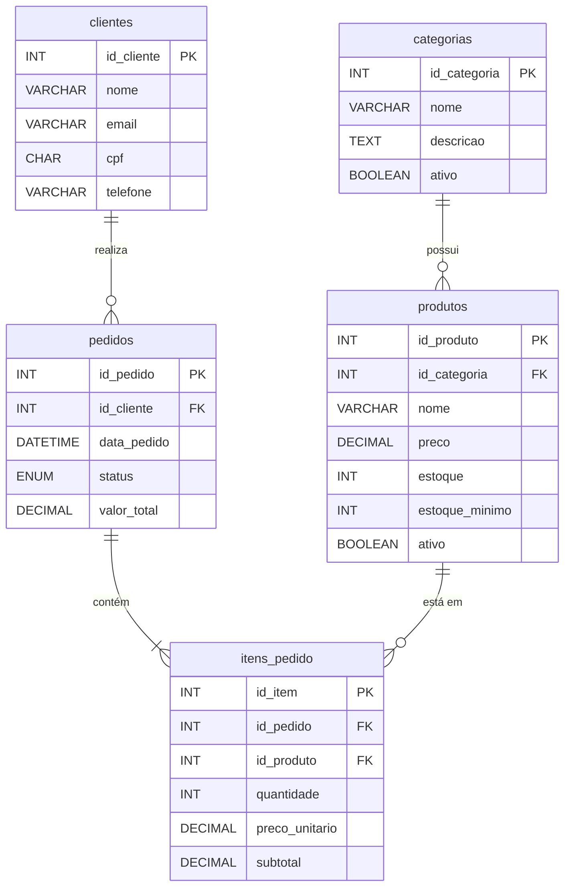

[README.md](https://github.com/user-attachments/files/35026987/README.md)
<div align="center">

# 🛒 TechStore — SQL, Stored Procedures e Views

**Consultas · Stored Procedures · Views no MySQL**


_Atividade individual de Banco de Dados · banco `loja_tech`_

</div>

---

## 👤 Identificação

| | |
|---|---|
| **Aluno(a)** | _seu nome aqui_ |
| **Disciplina / Turma** | _preencha_ |
| **Professor(a)** | _preencha_ |
| **Data** | Novembro/2026 |

---

## 📑 Sumário

1. [Sobre o projeto](#-sobre-o-projeto)
2. [O banco de dados](#-o-banco-de-dados-loja_tech)
3. [Estrutura do repositório](#-estrutura-do-repositório)
4. [Como executar](#️-como-executar)
5. [Parte 1 — Consultas SQL](#-parte-1--10-consultas-sql)
6. [Parte 2 — Stored Procedures](#️-parte-2--5-stored-procedures)
7. [Parte 3 — Views vs Stored Procedures](#️-parte-3--views-em-vez-de-stored-procedures)
8. [Aprendizados](#-aprendizados)
9. [Referências](#-referências)

---

## 📌 Sobre o projeto

Este repositório contém a resolução da atividade sobre **Stored Procedures no MySQL**, aplicada ao banco de dados da **TechStore**, uma loja fictícia de e-commerce de tecnologia.

A entrega tem três partes:

| Parte | Conteúdo | Arquivo |
|:-----:|----------|---------|
| **1** | 10 desafios de consultas SQL (nível muito fácil) | [`sql/01_consultas.sql`](sql/01_consultas.sql) |
| **2** | 5 exercícios de Stored Procedures (nível muito fácil) | [`sql/02_stored_procedures.sql`](sql/02_stored_procedures.sql) |
| **3** | Pesquisa: 5 situações em que **View** é melhor que Stored Procedure | [`sql/03_views.sql`](sql/03_views.sql) |

---

## 🗄️ O banco de dados `loja_tech`



> A tabela `log_operacoes` (auditoria) também faz parte do banco, mas não é usada nesta atividade.

---

## 🗂️ Estrutura do repositório

```
techstore-sql/
├── README.md
└── sql/
    ├── 00_setup_loja_tech.sql      ← criação do banco + carga inicial (script da aula)
    ├── 01_consultas.sql            ← Parte 1
    ├── 02_stored_procedures.sql    ← Parte 2
    └── 03_views.sql                ← Parte 3
```

---

## ▶️ Como executar

1. Abra o **MySQL Workbench** e conecte ao seu servidor.
2. Execute `sql/00_setup_loja_tech.sql` (cria o banco `loja_tech` e insere os dados iniciais).
3. Execute, nesta ordem: `01_consultas.sql` → `02_stored_procedures.sql` → `03_views.sql`.
4. Cada exercício tem, logo abaixo, um comando de teste (`SELECT` ou `CALL`).

> ⚠️ **Rode `02_stored_procedures.sql` uma única vez por carga do banco.** O teste de `inserir_categoria` insere uma nova linha a cada execução (`categorias.nome` não é `UNIQUE`). Para recomeçar, execute o `00_setup` de novo.

---

## 🔍 Parte 1 — 10 consultas SQL

| # | Desafio | Conceitos |
|:-:|---------|-----------|
| 1 | Nome e e-mail de todos os clientes | `SELECT` |
| 2 | Produtos que custam menos de R$ 500,00 | `WHERE` |
| 3 | Pedidos com status `pendente` | `WHERE` com texto |
| 4 | Produtos do mais caro ao mais barato | `ORDER BY ... DESC` |
| 5 | Produtos cujo nome contém "Monitor" | `LIKE '%...%'` |
| 6 | Periféricos (categoria 3) com mais de 40 unidades | `WHERE ... AND ...` |
| 7 | Total de clientes (`total_clientes`) | `COUNT(*)`, `AS` |
| 8 | Faturamento bruto (`faturamento_bruto`) | `SUM`, `AS` |
| 9 | Nome do produto + nome da categoria | `INNER JOIN` |
| 10 | Pedidos da cliente Ana Silva | `INNER JOIN` + `WHERE` |

**Exemplo — desafio 10:**

```sql
SELECT pe.id_pedido, pe.status, pe.valor_total
FROM pedidos pe
INNER JOIN clientes cl ON cl.id_cliente = pe.id_cliente
WHERE cl.nome = 'Ana Silva';
```

| id_pedido | status | valor_total |
|:---------:|--------|------------:|
| 1 | entregue | 3749.80 |
| 4 | processando | 6499.00 |

---

## ⚙️ Parte 2 — 5 stored procedures

| # | Procedure | Parâmetros | O que faz |
|:-:|-----------|------------|-----------|
| 1 | `listar_categorias_ativas()` | — | Lista categorias ativas em ordem alfabética |
| 2 | `buscar_pedidos_por_status` | `IN p_status VARCHAR(20)` | Filtra pedidos pelo status informado |
| 3 | `inserir_categoria` | `IN p_nome`, `IN p_descricao` | Insere uma nova categoria |
| 4 | `atualizar_telefone_cliente` | `IN p_id_cliente`, `IN p_telefone` | Atualiza o telefone de um cliente |
| 5 | `contar_produtos_categoria` | `IN p_id_categoria`, `OUT p_total` | Devolve a quantidade de produtos da categoria |

**Boas práticas aplicadas (conforme a aula):**

- ✅ `DROP PROCEDURE IF EXISTS` antes de cada `CREATE`
- ✅ `DELIMITER //` para o corpo da procedure
- ✅ Prefixo `p_` nos parâmetros (evita conflito com nomes de colunas)
- ✅ Nomes descritivos no formato verbo + substantivo
- ✅ Colunas listadas explicitamente (sem `SELECT *` dentro das procedures)

**Exemplo — procedure com `OUT`:**

```sql
DROP PROCEDURE IF EXISTS contar_produtos_categoria;
DELIMITER //
CREATE PROCEDURE contar_produtos_categoria(
    IN  p_id_categoria INT,
    OUT p_total        INT
)
BEGIN
    SELECT COUNT(*) INTO p_total
    FROM produtos
    WHERE id_categoria = p_id_categoria;
END //
DELIMITER ;

CALL contar_produtos_categoria(3, @total);
SELECT @total AS total_produtos_categoria;   -- 3 (Periféricos)
```

---

## 👁️ Parte 3 — Views em vez de Stored Procedures

### Quando usar cada uma?

| Critério | 👁️ View | ⚙️ Stored Procedure |
|----------|---------|---------------------|
| Objetivo | **Ler** dados (tabela virtual) | Executar **ações** e lógica |
| Escrita (`INSERT`/`UPDATE`/`DELETE`) | Em regra, só leitura | ✅ Sim |
| Parâmetros | ❌ Não | ✅ `IN` / `OUT` / `INOUT` |
| Uso em `FROM`, `JOIN`, `WHERE` | ✅ Sim | ❌ Só com `CALL` |
| Ferramentas de BI e relatórios | ✅ Leem direto | ⚠️ Suporte limitado |
| Controle de acesso | Restringe **colunas e linhas** | Restringe **ações** |
| Transações / `IF` / `WHILE` | ❌ | ✅ |

> **Regra de bolso:** se é só *consultar* dados, sem parâmetro e sem escrita, e você quer poder filtrar o resultado depois → **View**. Se precisa *fazer* algo (validar, gravar, usar transação) → **Stored Procedure**.

### Os 5 exemplos

| # | View | Situação real | Por que view e não procedure? |
|:-:|------|---------------|-------------------------------|
| 1 | `vw_catalogo_produtos` | A vitrine do site mostra produtos com categoria, e cada tela filtra de um jeito | Dá para aplicar `WHERE`/`ORDER BY` por cima do resultado; com `CALL` não |
| 2 | `vw_estoque_critico` | O setor de compras tem um painel com produtos abaixo do estoque mínimo | Não precisa de parâmetro; o dashboard lê a view como uma tabela sempre atualizada |
| 3 | `vw_resumo_pedidos` | O atendimento consulta pedidos + cliente + quantidade de itens o dia todo | Esconde o `JOIN`/`GROUP BY` e permite filtrar por status ou cliente |
| 4 | `vw_clientes_publico` | Um estagiário ou sistema terceiro lista clientes sem ver CPF, telefone e nascimento | Expõe só as colunas permitidas (LGPD); basta `GRANT SELECT` na view |
| 5 | `vw_vendas_por_categoria` | A diretoria quer um gráfico fixo de receita por categoria (sem cancelados) | Relatório agregado fixo que Power BI, Metabase ou Excel consomem direto |

**Exemplo — view 4 (segurança por colunas):**

```sql
CREATE OR REPLACE VIEW vw_clientes_publico AS
SELECT id_cliente, nome, email, criado_em
FROM clientes
WHERE ativo = TRUE;

-- O usuário só enxerga a view, nunca a tabela:
-- GRANT SELECT ON loja_tech.vw_clientes_publico TO 'estagiario'@'localhost';
```

> 📝 Com a carga inicial, `vw_estoque_critico` retorna **vazio** (nenhum produto está abaixo do mínimo). O arquivo `03_views.sql` traz um `UPDATE` de demonstração para mostrar a view funcionando.

---

## 🧠 Aprendizados

- **Procedure = fazer.** Cadastrar, atualizar, cancelar, validar e usar transações.
- **View = enxergar.** Consultas reaproveitáveis, simples e seguras.
- As duas se complementam: a aplicação **lê** por views e **escreve** por procedures.
- Nomear parâmetros com `p_` evita ambiguidade com colunas nas cláusulas `WHERE`.
- O princípio do **menor privilégio** funciona com as duas: `GRANT EXECUTE` em procedures e `GRANT SELECT` em views, sem acesso direto às tabelas.

---

## 📚 Referências

- Material da aula: **Stored Procedures no MySQL** (banco `loja_tech`).
- MySQL 8.0 Reference Manual — [Stored Objects](https://dev.mysql.com/doc/refman/8.0/en/stored-objects.html)
- MySQL 8.0 Reference Manual — [CREATE PROCEDURE](https://dev.mysql.com/doc/refman/8.0/en/create-procedure.html)
- MySQL 8.0 Reference Manual — [CREATE VIEW](https://dev.mysql.com/doc/refman/8.0/en/create-view.html)
- MySQL 8.0 Reference Manual — [Stored Object Access Control](https://dev.mysql.com/doc/refman/8.0/en/stored-objects-security.html)

---

<div align="center">

Atividade individual · Feito com ☕ e muito `SELECT`

</div>
